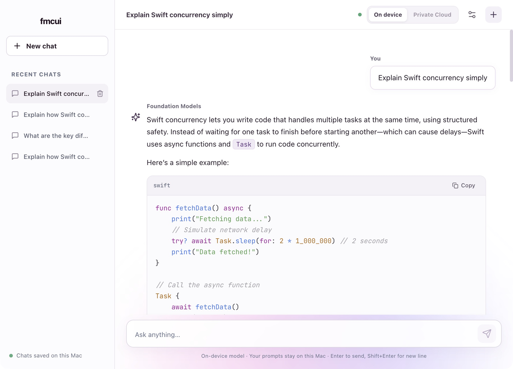
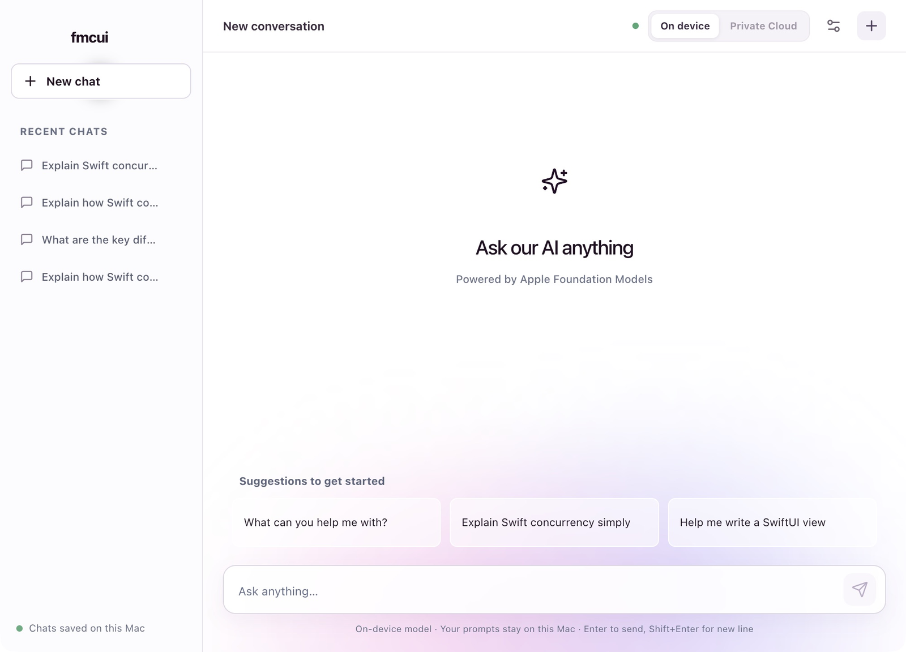

# fmcui

A macOS chat app for Apple Foundation Models, built with Electron, React, and Vite. It starts the system `fm serve` process on a loopback port and keeps conversation history in the app's local data directory. [View the project page](https://suyash-03.github.io/fmcui-product-portfolio/).

## Screenshots

**Conversation**



**New chat**



## Requirements

- macOS 27 or later with Apple Intelligence available and the `fm` CLI installed.
- Accept the CLI license if prompted: `sudo fm license`.

## Models

**On device** is the default. Prompts stay on your Mac and use the `system` model. **Private Cloud** becomes selectable when the running `fm serve` reports the `pcc` model as available. Selecting it sends the conversation to Apple's Private Cloud Compute, which supports more context and reasoning but needs network access and has daily usage limits. The app never silently changes models or sends an on-device conversation to the cloud.

Private Cloud Compute availability depends on the OS, device, region, Apple Intelligence status, and Apple's access rules. Apple documents the [Private Cloud Compute model](https://developer.apple.com/documentation/foundationmodels/adding-server-side-intelligence-with-private-cloud-compute) and [access requirements](https://developer.apple.com/private-cloud-compute/).

## Run locally

```bash
npm install
npm run dev
```

`npm run build` produces the renderer and Electron bundles. Browser-only development expects an `fm serve` process on port 8462 for the Vite proxy. The packaged Electron app starts its own server on a free loopback port.
